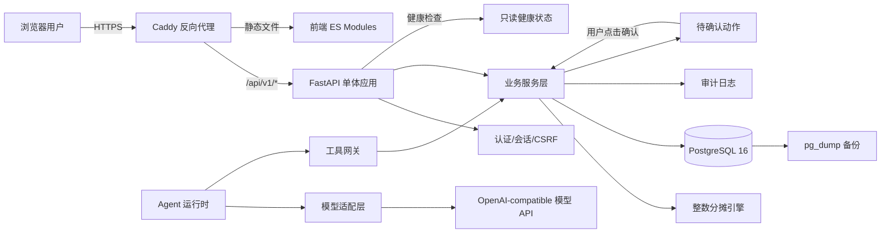
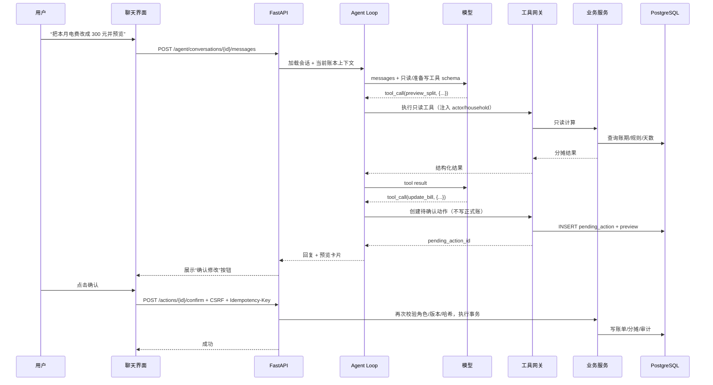
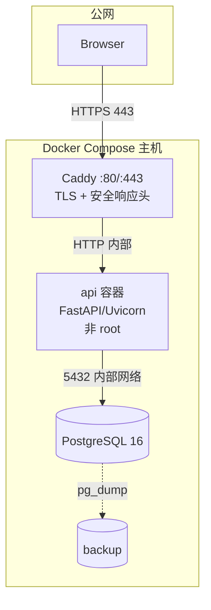

# 阶段 1：技术选型与系统架构

- 状态：阶段 0–6 已完成；阶段 7 交付物/备份恢复/静态验证已完成，Docker/CI 运行时未执行。
- 目标：单实例、可多人访问、可审计、可备份的合租账单 Agent 系统。
- 原则：账务正确性 > 历史可追溯性 > 数据安全 > 功能数量 > 技术新颖度。

---

## 1. 对原技术方案的评估

原方案整体适合本项目。它是一个典型的“小型多用户业务系统 + 一个受控 AI 入口”，不需要微服务、消息队列、向量数据库或多 Agent 框架。

| 技术 | 结论 | 说明与调整 |
|---|---|---|
| 保留 HTML/CSS/JS | **采用，但模块化** | 保留现有视觉和 DOM 契约；拆成 ES modules，不引入 React/Vue。聊天、账期、权限会增加状态复杂度，用一个小型 store/controller 控制，避免把逻辑继续堆在单个 IIFE 中 |
| Python + FastAPI | **采用** | 同步 SQLAlchemy 路由由 FastAPI 线程池执行，避免 async ORM 带来的学习成本；只有模型调用和未来 SSE 需要异步时再局部使用 |
| PostgreSQL | **采用** | 需要事务、部分唯一索引、JSONB 快照、并发锁、可靠备份。SQLite 虽然部署更简单，但并发写、约束能力和运维迁移不适合“多人真实收款” |
| SQLAlchemy | **采用 2.0 同步风格** | 使用 `select()`、显式事务、`Session`；不混用 async engine。模型层与业务服务层分离 |
| Alembic | **采用** | 所有结构变化必须通过迁移；CI 验证“空库升级到 head” |
| Pydantic | **采用 v2** | 请求/响应/工具参数统一校验；金额字段用整数分；禁止 `float` |
| 支持工具调用的模型 API | **采用，自建薄适配层** | 使用 OpenAI-compatible Chat Completions 工具调用协议；不引入 LangChain/LlamaIndex。提供 `FakeProvider` 用于离线测试 |
| pytest | **采用** | 单元 + 集成 + 业务流程 + Agent 假模型 + 并发 + 恢复测试；分摊算法加 Hypothesis 属性测试 |
| Docker Compose + HTTPS 反代 | **采用** | `api` + `postgres` + `caddy` 三个服务；数据库不暴露公网端口；Caddy 自动 HTTPS |
| Git + GitHub | **采用** | 分支保护、CI、Dependabot、Release；MIT License |
| GitHub Actions | **采用** | Postgres service、迁移、lint、测试、依赖审计；可选 Playwright 冒烟 |

### 1.1 不建议引入的技术

| 技术 | 不采用的原因 |
|---|---|
| 微服务/Kubernetes | 单人家用规模，网络、部署、排障成本远大于收益 |
| 多 Agent 框架 | 业务边界清晰，单 Agent + 确定性工具足够；多 Agent 会增加不可预测性和调试成本 |
| LangChain/LlamaIndex | 需要的只是“模型调用 + 工具循环 + 统一适配”，自建约几百行更可控，避免框架升级和隐式行为 |
| Redis/Celery | v1 没有异步任务队列需求；备份、导出、结算都在请求内完成。限流先用单实例内存 + 数据库登录锁定 |
| JWT + localStorage | 浏览器端持久令牌易受 XSS；改用 HttpOnly Cookie + 服务端会话，支持即时吊销 |
| 前端 SPA 框架 | 页面规模有限，保留原生 HTML 更符合“低维护成本”；用 ES modules 和组件函数控制复杂度 |
| SQLite | 单文件备份简单，但并发写、部分唯一索引、JSONB、在线恢复和多人可靠性不如 PostgreSQL |
| 事件溯源（Event Sourcing） | 当前需求用“不可变付款 + 结算快照 + 审计日志”即可；完整事件溯源过度设计 |

### 1.2 需要特别说明的取舍

1. **同步 SQLAlchemy 而不是 async**：家用规模下数据库延迟不是瓶颈。同步代码更容易写事务、锁和测试。FastAPI 会把同步路由放入线程池。
2. **不使用前端构建链**：前端是静态 ES modules，由 FastAPI/Caddy 提供；不需要 Node.js 才能运行。Playwright 只在 CI 中使用。
3. **模型不参与算钱**：LLM 只提取参数、选择工具、组织解释。所有金额由 Python 整数引擎计算。
4. **写操作两阶段**：Agent 的写工具只生成“待确认动作”，真正落库由用户在界面上确认后调用受保护的确认接口。模型不能自己确认。
5. **规则版本按账本整体管理**：一个账本同一时刻只有一个 `active` 规则版本；版本内包含各账单分类的规则项。历史结算保存完整快照，不依赖当前版本。

---

## 2. 系统上下文



### 2.1 信任边界

| 边界 | 规则 |
|---|---|
| 浏览器 ↔ 服务端 | 只信 HttpOnly 会话 Cookie + CSRF Token；前端传入的 `household_id`、角色、金额都必须服务端复核 |
| Agent ↔ 工具层 | 模型输出不可信；工具参数经 Pydantic 校验；工具层从会话注入 `actor_id/household_id/role`，不接受模型传入的权限字段 |
| 服务端 ↔ 数据库 | 只通过 SQLAlchemy/参数化 SQL；禁止字符串拼接 SQL |
| 服务端 ↔ 模型 API | API Key 仅服务端环境变量；请求只带必要账务摘要；模型无数据库凭据 |
| 公网 ↔ 容器 | 只有 Caddy 暴露 80/443；Postgres 只在内部网络 |

---

## 3. 运行时组件

### 3.1 Web/前端

- 静态 HTML/CSS/ES modules。
- 页面：
  - 登录/注册/邀请接受；
  - 账本选择；
  - 账期切换；
  - 账单看板（保留旧页面布局）；
  - 规则管理与版本预览；
  - 实际收款；
  - 结算预览/正式结算/历史结算；
  - 审计日志；
  - Agent 聊天侧栏/独立页。
- 不在浏览器保存 API Key、数据库密码或正式账目唯一副本。
- 所有金额格式化来自服务端返回的 `*_cents` 字段，前端只负责显示。
- 所有用户文本通过 `textContent` 渲染；不使用 `innerHTML` 拼用户内容。

### 3.2 API 与业务服务

建议按领域拆服务，但仍在同一进程：

| 服务 | 职责 |
|---|---|
| `auth_service` | 注册、登录、会话、密码、CSRF、登录锁定 |
| `household_service` | 账本、成员、邀请、角色 |
| `people_service` | 人员、用户绑定 |
| `period_service` | 账期、入住天数、锁定/重开 |
| `bill_service` | 账单 CRUD、作废、重算、分摊明细 |
| `allocation_engine` | 纯函数：整数分、权重、零头归属、备用规则、守恒校验 |
| `rule_service` | 规则版本、草稿、预览、激活、影响计算 |
| `payment_service` | 实收/调整流水、冲正 |
| `settlement_service` | 预览、正式快照、修订、查询、导出 |
| `audit_service` | 追加审计、脱敏、查询 |
| `agent_service` | 会话、消息、工具循环、待确认动作 |
| `export_service` | CSV 生成、注入防护 |

事务边界在服务层，不在路由层。路由只做认证、参数解析、调用服务、映射响应。

### 3.3 数据层

- PostgreSQL 16。
- SQLAlchemy 2.0 同步 Session。
- Alembic 迁移。
- 连接池：小规模（`pool_size=5`, `max_overflow=5`）。
- 金额：`bigint` 分；Python `int`；禁止 `float`。
- 时间：数据库 `timestamptz` UTC；业务日期 `date`；显示时用账本时区（默认 `Asia/Shanghai`）。
- JSONB：规则快照、结算账单快照、审计前后值、Agent 工具参数/结果。

### 3.4 Agent 运行时



更完整的工具和确认设计见 `docs/agent.md`。

---

## 4. 部署拓扑



- 只暴露 Caddy 的 80/443。
- Postgres 不发布宿主机端口；仅 Docker 内部网络。
- API 以非 root 用户运行；只读文件系统可写 `/tmp`。
- 生产环境 `Secure` Cookie + HSTS；开发环境可通过 `COOKIE_SECURE=false` 在 localhost 使用。
- 备份使用宿主机 cron/systemd timer 调用 `pg_dump -Fc`，不把备份放在数据库容器内。
- 单实例优先；如扩展到多实例，需把内存限流迁移到 Redis，并确保迁移只跑一次。

---

## 5. 项目目录结构（规划）

```text
roommate-billing-agent/
├── README.md
├── LICENSE                         # MIT
├── CONTRIBUTING.md
├── SECURITY.md
├── CHANGELOG.md
├── .gitignore
├── .editorconfig
├── .env.example
├── .dockerignore
├── pyproject.toml
├── uv.lock
├── Dockerfile
├── docker-compose.yml
├── docker-compose.prod.yml
├── Caddyfile
├── alembic.ini
├── Makefile
├── docs/
│   ├── README.md
│   ├── phase-0-audit.md
│   ├── phase-2-report.md
│   ├── phase-3-report.md
│   ├── phase-4-report.md
│   ├── phase-5-report.md
│   ├── phase-6-report.md
│   ├── phase-7-report.md
│   ├── architecture.md
│   ├── database.md
│   ├── api.md
│   ├── agent.md
│   ├── security.md
│   ├── testing.md
│   ├── deployment.md
│   ├── github-release.md
│   ├── roadmap.md
│   └── audits/
│       ├── legacy-split-audit.mjs
│       └── legacy-split-audit-results.json
├── legacy/
│   └── 合租账单分摊器.html         # 只读存档，不再修改
├── migrations/
│   ├── env.py
│   ├── script.py.mako
│   └── versions/
│       └── 0001_initial.py
├── src/
│   └── roommate_billing/
│       ├── __init__.py
│       ├── main.py
│       ├── config.py
│       ├── logging.py
│       ├── cli.py
│       ├── db/
│       │   ├── base.py
│       │   ├── session.py
│       │   ├── enums.py
│       │   ├── types.py
│       │   └── models/
│       │       ├── __init__.py
│       │       ├── users.py
│       │       ├── households.py
│       │       ├── billing.py
│       │       ├── rules.py
│       │       ├── payments.py
│       │       ├── settlements.py
│       │       ├── audit.py
│       │       └── agent.py
│       ├── domain/
│       │   ├── money.py
│       │   ├── allocation.py
│       │   ├── allocation_types.py
│       │   └── errors.py
│       ├── schemas/
│       │   ├── auth.py
│       │   ├── households.py
│       │   ├── billing.py
│       │   ├── rules.py
│       │   ├── payments.py
│       │   ├── settlements.py
│       │   ├── agent.py
│       │   └── common.py
│       ├── services/
│       │   ├── auth.py
│       │   ├── households.py
│       │   ├── people.py
│       │   ├── periods.py
│       │   ├── bills.py
│       │   ├── rules.py
│       │   ├── payments.py
│       │   ├── settlements.py
│       │   ├── audit.py
│       │   ├── exports.py
│       │   └── actions.py
│       ├── api/
│       │   ├── deps.py
│       │   ├── errors.py
│       │   ├── middleware.py
│       │   └── v1/
│       │       ├── router.py
│       │       ├── auth.py
│       │       ├── households.py
│       │       ├── people.py
│       │       ├── periods.py
│       │       ├── bills.py
│       │       ├── rules.py
│       │       ├── payments.py
│       │       ├── settlements.py
│       │       ├── actions.py
│       │       ├── audit.py
│       │       ├── agent.py
│       │       └── health.py
│       ├── agent/
│       │   ├── loop.py
│       │   ├── prompts.py
│       │   ├── tools.py
│       │   ├── confirmations.py
│       │   ├── guardrails.py
│       │   └── providers/
│       │       ├── base.py
│       │       ├── openai_compatible.py
│       │       └── fake.py
│       ├── security/
│       │   ├── passwords.py
│       │   ├── sessions.py
│       │   ├── csrf.py
│       │   ├── rate_limit.py
│       │   ├── headers.py
│       │   └── redaction.py
│       └── static/
│           ├── index.html
│           ├── css/
│           │   ├── tokens.css
│           │   ├── legacy.css
│           │   └── app.css
│           └── js/
│               ├── app.js
│               ├── api.js
│               ├── store.js
│               ├── auth.js
│               ├── ledger.js
│               ├── bills.js
│               ├── rules.js
│               ├── settlements.js
│               ├── chat.js
│               ├── actions.js
│               ├── audit.js
│               ├── format.js
│               └── components/
│                   ├── modal.js
│                   ├── toast.js
│                   ├── table.js
│                   └── diff.js
├── tests/
│   ├── conftest.py
│   ├── unit/
│   │   ├── test_allocation.py
│   │   ├── test_money.py
│   │   └── test_permissions.py
│   ├── integration/
│   │   ├── test_auth.py
│   │   ├── test_households.py
│   │   ├── test_bills.py
│   │   ├── test_rules.py
│   │   ├── test_payments.py
│   │   ├── test_settlements.py
│   │   ├── test_isolation.py
│   │   ├── test_idempotency.py
│   │   ├── test_concurrency.py
│   │   └── test_audit.py
│   ├── agent/
│   │   ├── test_tool_loop.py
│   │   ├── test_missing_args.py
│   │   ├── test_confirmation.py
│   │   ├── test_provider_failure.py
│   │   └── test_prompt_injection.py
│   ├── e2e/
│   │   └── test_smoke.spec.ts
│   └── fixtures/
│       ├── __init__.py
│       ├── factories.py
│       └── sample_ledger.py
├── scripts/
│   ├── backup.sh
│   ├── restore.sh
│   ├── smoke.sh
│   └── check_no_secrets.sh
├── .github/
│   ├── workflows/
│   │   ├── ci.yml
│   │   └── release.yml
│   ├── dependabot.yml
│   └── pull_request_template.md
└── runbooks/
    ├── backup-restore.md
    └── incident.md
```

> 阶段 0/1 创建了 `docs/`、`docs/audits/`、`legacy/`；阶段 2 创建了 `pyproject.toml`、`uv.lock`、`domain/` 和 `tests/unit/`；阶段 3 创建了 `db/`、`services/`、`api/`、`migrations/`、`schemas/` 和 `tests/integration/`。其余前端/Agent/Docker 文件仍是规划。

---

## 6. 关键数据流

### 6.1 普通页面请求

```text
Cookie(session) → 会话校验 → 用户 → 账本成员校验 → 服务层 → 事务 → 审计 → JSON
```

- 路径参数中的 `household_id` 与当前用户成员关系必须匹配。
- 不在请求体中信任 `role`、`actor_id`、`household_id`。
- 所有列表接口强制账本过滤。

### 6.2 分摊重算

```text
账期 + 入住天数 + 规则版本 + 账单
  → 整数分摊引擎
  → 每笔账单守恒校验
  → bill_allocations
  → 审计（旧值/新值）
```

- 只允许在 `open` 账期重算账单。
- 规则激活只影响 `open` 账期；`locked/settled` 账期不重算。
- 每笔账单分摊后立即断言守恒；失败回滚事务。

### 6.3 正式结算

```text
锁账期 FOR UPDATE
  → 读取当前账单/分摊/有效规则/实收
  → 重新计算并比对预览哈希
  → 插入 settlement + lines + 快照
  → 旧 final 标记 superseded（修订场景）
  → 锁定账期/写审计
```

### 6.4 Agent 写操作

```text
模型调写工具
  → 工具网关只创建 pending_action（预览、哈希、过期时间）
  → 返回需要用户确认
  → 用户在 UI 点击确认
  → POST /actions/{id}/confirm（会话 + CSRF + 幂等键）
  → 服务端复核权限/哈希/版本 → 执行 → 消耗动作
```

---

## 7. 环境变量（规划）

`.env.example` 只放示例，不放真实值。

| 变量 | 必填 | 说明 |
|---|---|---|
| `APP_ENV` | 是 | `development` / `production` / `test` |
| `APP_BASE_URL` | 是 | 例：`https://billing.example.com` |
| `APP_SECRET_KEY` | 是 | 至少 32 字节随机值；用于 CSRF/IP 哈希的 pepper |
| `DATABASE_URL` | 是 | `postgresql+psycopg://...`，仅服务端 |
| `POSTGRES_DB` / `POSTGRES_USER` / `POSTGRES_PASSWORD` | Docker | 仅数据库容器/Compose |
| `SESSION_COOKIE_SECURE` | 生产必填 | 生产 `true` |
| `SESSION_TTL_HOURS` | 否 | 默认 168 小时 |
| `ALLOW_REGISTRATION` | 否 | 默认 `false`；首次部署可临时开启 |
| `BOOTSTRAP_ADMIN_EMAIL` | 首次部署 | 仅 CLI/一次性引导，不写入镜像 |
| `LLM_ENABLED` | 否 | 默认 `false`；关闭后核心账务仍可用 |
| `LLM_BASE_URL` | 否 | OpenAI-compatible 接口 |
| `LLM_API_KEY` | 否 | **只在服务端**；不得进前端/仓库 |
| `LLM_MODEL` | 否 | 支持工具调用的模型名 |
| `LLM_TIMEOUT_SECONDS` | 否 | 默认 30 |
| `AGENT_MAX_STEPS` | 否 | 默认 8 |
| `AGENT_MAX_INPUT_CHARS` | 否 | 默认 4000 |
| `LOG_LEVEL` | 否 | 默认 `INFO` |
| `TRUSTED_PROXY` | 生产 | 仅信任 Caddy 的代理头 |
| `BACKUP_DIR` | 否 | 宿主机备份目录 |

### 7.1 密钥管理

- 本地：`.env`（已被 `.gitignore` 忽略）。
- 生产：Docker Compose `.env` 文件权限 600，或 Docker secrets/系统环境变量。
- 绝不把 `.env`、数据库密码、API Key、真实账单、真实姓名或访问令牌提交到 Git。
- 日志、错误响应、健康检查不得输出配置值。
- 轮换 API Key/数据库密码需有 runbook。

---

## 8. 可观测性与运维

### 8.1 日志

- 结构化 JSON（生产）或可读格式（开发）。
- 每条请求带 `request_id`、方法、路径、状态码、耗时、用户 ID（不是邮箱）、账本 ID。
- **不记录**：密码、会话令牌、CSRF、API Key、完整账单备注、支付参考号、聊天原文。
- 慢查询/异常堆栈记录，但脱敏。
- 审计日志与运行日志分离；审计是业务记录，不用于调试。

### 8.2 指标（v1 可只输出日志）

- 请求数/错误率/延迟；
- 登录失败次数；
- Agent 工具调用失败率、模型超时；
- 结算创建次数；
- 数据库连接池使用率。

v1 不引入 Prometheus/Grafana；家用规模用日志和健康检查足够。后续可加。

### 8.3 健康检查

- `GET /health/live`：进程存活，不查 DB，不泄露配置。
- `GET /health/ready`：执行 `SELECT 1`；数据库不可用时 503。
- 响应仅 `{"status":"ok"}` 或 `{"status":"unavailable"}`，不含版本、DSN、异常详情（详情仅日志）。
- 不要求认证，但只暴露最小信息。

---

## 9. 关键架构决策记录（ADR 摘要）

| ID | 决策 | 理由 | 后果 |
|---|---|---|---|
| ADR-001 | 单体应用 | 规模小、事务边界清晰、易部署 | 后续拆分成本可控；v1 不拆 |
| ADR-002 | PostgreSQL | 事务/约束/JSONB/备份 | 需要容器和运维；换取可靠性 |
| ADR-003 | 整数分 | 避免浮点误差 | 所有输入/输出/工具参数都用分；显示层转换 |
| ADR-004 | 服务端会话 + HttpOnly Cookie | 可吊销、避免 localStorage XSS | 需要会话表、CSRF、Cookie 配置 |
| ADR-005 | 原生 ES modules | 保留现有页面、低构建复杂度 | 需要自律的模块边界和状态管理 |
| ADR-006 | 单 Agent + 工具白名单 | 可控、可测、可解释 | 不做多 Agent 编排 |
| ADR-007 | Agent 只提议，服务端执行 | 防止模型越权和幻觉落账 | 需要 pending_action/确认流程 |
| ADR-008 | 同步 SQLAlchemy | 事务/锁/测试简单 | 高并发时需线程池/多实例扩展 |
| ADR-009 | 规则版本 + 结算快照 | 历史可追溯 | 数据量略增，换取审计能力 |
| ADR-010 | 付款只追加、结算不可变 | 历史收款不被覆盖 | 修正通过冲正/新结算修订 |

---

## 10. 非功能目标

| 指标 | v1 目标 |
|---|---|
| 账本规模 | 1–50 人，单账本 1–20 人 |
| 单账期账单 | 1–200 笔 |
| 并发用户 | 1–20 |
| 页面首屏 | 局域网/普通公网 < 2 秒 |
| 分摊计算 | 单账期 < 100ms（不含网络） |
| Agent 首响应 | < 30 秒超时；工具最多 8 步 |
| 可用性 | 家用/小团队，非 99.99% SLA |
| 数据保留 | 付款/结算/审计永久保留，归档策略后续定义 |
| 恢复目标 | 每日备份；RPO 24h，RTO 2h（v1，可后续加 WAL） |

---

## 11. 主要风险与缓解

| 风险 | 影响 | 缓解 |
|---|---|---|
| 把自动估算当真实收款 | 账目错误、纠纷 | 旧基线只作建议；必须人工录入/确认；UI 显示来源 |
| Agent 幻觉金额 | 错误结算 | 模型不计算；前端展示服务端结果；测试一致性 |
| 提示注入（备注/聊天） | 越权/错误操作 | 工具白名单、数据/指令分离、写操作二次确认、模型无法自确认 |
| 并发覆盖 | 账目错乱 | 行锁、版本号、唯一约束、幂等键、并发测试 |
| 迁移遗漏 | 历史丢失 | 旧文件存档、差异文档、备份、迁移测试 |
| 备份不可恢复 | 灾难性丢失 | 定期恢复演练、校验、异地副本 |
| 依赖漏洞 | 安全事件 | 锁定依赖、Dependabot、pip-audit、最小镜像 |
| 公网暴露配置错误 | 数据泄露 | 只暴露 Caddy、HTTPS、强密码、限流、健康检查脱敏 |

---

## 12. 阶段 1 架构验收

- [x] 完成旧系统审查并保留原文件
- [x] 完成技术选型评估
- [x] 完成系统上下文、部署拓扑、请求/Agent 数据流
- [x] 完成规划目录结构
- [x] 明确单体、同步 SQLAlchemy、服务端会话、无多 Agent
- [x] 明确金额引擎与 Agent 的边界
- [x] 明确安全/运维/非功能目标
- [x] 用户确认历史收款语义、账期关闭/修正流程、负数/天数/确认工具策略
- [x] 用户确认后进入阶段 2
- [x] 许可证：MIT

**阶段 1 门禁：已满足；阶段 2–6 已完成；阶段 7 部分验证，见 `docs/phase-2-report.md` 至 `docs/phase-7-report.md`。**
