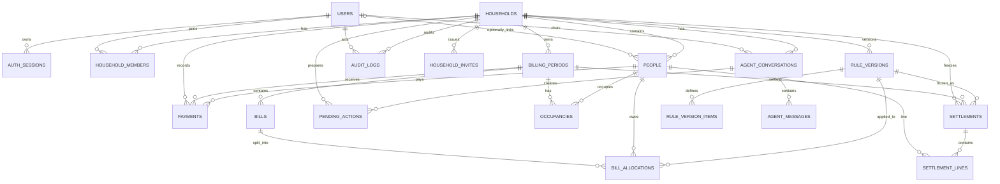

# 阶段 1：PostgreSQL 数据模型设计

- 数据库：PostgreSQL 16+
- ORM：SQLAlchemy 2.0（同步）
- 迁移：Alembic
- 金额：`bigint`，单位“分”；Python 侧一律 `int`
- 时间：`timestamptz` 存 UTC；业务日期用 `date`；显示按账本时区（默认 `Asia/Shanghai`）
- 主键：UUID（`gen_random_uuid()`）
- 枚举：使用 `varchar + CHECK`，不使用 PostgreSQL ENUM，便于 Alembic 演进
- 删除：财务数据不物理删除；账单作废、付款冲正、账本归档
- 租户字段：所有账本内表都带 `household_id`；关键父子关系使用**复合外键**，防止跨账本引用

> 本文是设计，不是已执行的迁移。阶段 3 已实现 15 张核心账务表；阶段 4 已实现 `auth_sessions`、`household_invites`；阶段 5 已实现 `agent_conversations`、`agent_messages`、`pending_actions`（共 20 张表）。

---

## 1. 设计原则

1. **金额绝不使用浮点**：数据库 `bigint` 分，Python `int`，API 字段以 `*_cents` 命名。
2. **历史不可变**：付款只追加；正式结算和结算行不可更新；规则激活后不可修改。
3. **实时数据可重算，历史数据只快照**：账单草稿可重算；结算保存当时的规则、账单、分摊、实收。
4. **账本隔离是硬约束**：不仅靠查询条件，还用 `(household_id, id)` 复合外键保证父子记录属于同一账本。
5. **幂等与并发是数据模型的一部分**：唯一约束、版本号、行锁、幂等表，不靠“前端别点两次”。
6. **能约束的进数据库，跨行的进事务 + 服务层断言**：单行金额、状态、符号由 CHECK 保证；每笔账单分摊合计、结算合计由服务层在同一事务中校验。
7. **不静默丢历史**：旧页面的自动基线只作为建议，不写入 `payments`；旧 HTML 原样存档。

---

## 2. ER 关系图



---

## 3. 表清单与用途

| 表 | 用途 |
|---|---|
| `users` | 全局登录账户 |
| `auth_sessions` | 服务端会话，支持吊销 |
| `households` | 合租账本（数据隔离边界） |
| `household_members` | 用户与账本的角色关系 |
| `household_invites` | 一次性邀请码 |
| `people` | 账本内的人员，可绑定也可不绑定登录账户 |
| `billing_periods` | 账期（月），状态与版本 |
| `occupancies` | 每人每账期的入住天数 |
| `bills` | 账期内的账单 |
| `rule_versions` | 规则版本头信息 |
| `rule_version_items` | 规则版本中每个账单分类的分摊方法 |
| `bill_allocations` | 当前账单的逐人分摊明细（可重算） |
| `payments` | 实际收款/调整流水（只追加） |
| `settlements` | 正式结算快照（规则/账单/实收） |
| `settlement_lines` | 结算中每个人的应承担、实收、差额 |
| `audit_logs` | 追加式审计日志 |
| `agent_conversations` | Agent 会话 |
| `agent_messages` | Agent 消息和工具调用记录 |
| `pending_actions` | 需要用户确认的 Agent 写操作 |
| `idempotency_keys` | 重复请求去重 |

---

## 4. 字段设计

> 说明：每张账本内表都有 `household_id`。为支持复合外键，父表额外声明 `UNIQUE (household_id, id)`；`id` 本身仍是主键。

### 4.1 `users`

| 字段 | 类型 | 可空 | 默认 | 约束/说明 |
|---|---|---|---|---|
| `id` | `uuid` | 否 | `gen_random_uuid()` | PK |
| `email` | `varchar(320)` | 否 | — | 小写规范化；`UNIQUE (email)`；`CHECK (email = lower(email))` |
| `display_name` | `varchar(80)` | 否 | — | 显示名 |
| `password_hash` | `text` | 是（阶段 3） | — | Argon2id 哈希；阶段 4 接入登录后改为 NOT NULL |
| `is_active` | `boolean` | 否 | `true` | 禁用后不可登录 |
| `failed_login_count` | `smallint` | 否 | `0` | 连续失败次数 |
| `locked_until` | `timestamptz` | 是 | `NULL` | 临时锁定截止时间 |
| `last_login_at` | `timestamptz` | 是 | `NULL` | 最后登录 |
| `password_changed_at` | `timestamptz` | 否 | `now()` | 改密后可吊销旧会话 |
| `created_at` | `timestamptz` | 否 | `now()` | |
| `updated_at` | `timestamptz` | 否 | `now()` | 应用维护 |

索引/约束：

- `UNIQUE (email)`。
- 登录失败计数和锁定字段不对外返回。

### 4.2 `auth_sessions`

| 字段 | 类型 | 可空 | 默认 | 约束/说明 |
|---|---|---|---|---|
| `id` | `uuid` | 否 | `gen_random_uuid()` | PK |
| `user_id` | `uuid` | 否 | — | FK → `users.id`，`ON DELETE RESTRICT` |
| `token_hash` | `char(64)` | 否 | — | 会话令牌 SHA-256 十六进制；唯一 |
| `csrf_hash` | `char(64)` | 否 | — | CSRF Token 的 HMAC-SHA256（使用 `APP_SECRET_KEY`）；不返回明文 |
| `created_at` | `timestamptz` | 否 | `now()` | |
| `last_seen_at` | `timestamptz` | 否 | `now()` | 空闲超时依据 |
| `expires_at` | `timestamptz` | 否 | — | 绝对过期时间 |
| `revoked_at` | `timestamptz` | 是 | `NULL` | 主动登出/改密吊销 |
| `ip_hash` | `char(64)` | 是 | `NULL` | 不存原始 IP |
| `user_agent` | `varchar(512)` | 是 | `NULL` | 截断保存 |

索引/约束：

- `UNIQUE (token_hash)`。
- `INDEX (user_id, revoked_at, expires_at)`。
- `INDEX (expires_at)` 用于清理。

### 4.3 `households`

| 字段 | 类型 | 可空 | 默认 | 约束/说明 |
|---|---|---|---|---|
| `id` | `uuid` | 否 | `gen_random_uuid()` | PK |
| `name` | `varchar(120)` | 否 | — | 账本名 |
| `currency` | `char(3)` | 否 | `'CNY'` | v1 仅 CNY |
| `timezone` | `varchar(64)` | 否 | `'Asia/Shanghai'` | IANA 时区 |
| `status` | `varchar(16)` | 否 | `'active'` | `active/archived` |
| `version` | `integer` | 否 | `1` | 乐观锁版本 |
| `created_by` | `uuid` | 否 | — | FK → `users.id` |
| `created_at` | `timestamptz` | 否 | `now()` | |
| `updated_at` | `timestamptz` | 否 | `now()` | |

索引/约束：

- `UNIQUE (id)` 隐含；额外 `UNIQUE (id, created_by)` 不必要。
- 归档账本仍可查询，禁止新写入。

### 4.4 `household_members`

| 字段 | 类型 | 可空 | 默认 | 约束/说明 |
|---|---|---|---|---|
| `household_id` | `uuid` | 否 | — | FK → `households.id` |
| `user_id` | `uuid` | 否 | — | FK → `users.id` |
| `role` | `varchar(16)` | 否 | `'member'` | `owner/admin/member` |
| `status` | `varchar(16)` | 否 | `'active'` | `active/left` |
| `joined_at` | `timestamptz` | 否 | `now()` | |
| `left_at` | `timestamptz` | 是 | `NULL` | |

索引/约束：

- `PRIMARY KEY (household_id, user_id)`。
- `CHECK (role IN ('owner','admin','member'))`。
- `CHECK (status IN ('active','left'))`。
- `UNIQUE INDEX ... ON household_members (household_id) WHERE role='owner' AND status='active'`：每个账本一个有效 owner。
- `INDEX (user_id)`：列出某用户加入的账本。

### 4.5 `household_invites`

| 字段 | 类型 | 可空 | 默认 | 约束/说明 |
|---|---|---|---|---|
| `id` | `uuid` | 否 | `gen_random_uuid()` | PK |
| `household_id` | `uuid` | 否 | — | FK → `households.id` |
| `email` | `varchar(320)` | 是 | `NULL` | 可选，预先指定邀请对象 |
| `role` | `varchar(16)` | 否 | `'member'` | 仅 `admin/member`，不允许邀请 owner |
| `token_hash` | `char(64)` | 否 | — | 一次性邀请码哈希 |
| `expires_at` | `timestamptz` | 否 | — | 建议 7 天 |
| `created_by` | `uuid` | 否 | — | FK → `users.id` |
| `created_at` | `timestamptz` | 否 | `now()` | |
| `accepted_by` | `uuid` | 是 | `NULL` | FK → `users.id` |
| `accepted_at` | `timestamptz` | 是 | `NULL` | |

索引/约束：

- `UNIQUE (token_hash)`。
- `INDEX (household_id, accepted_at, expires_at)`。
- 同一 token 只能被接受一次；服务层用行锁/条件更新保证。

### 4.6 `people`

| 字段 | 类型 | 可空 | 默认 | 约束/说明 |
|---|---|---|---|---|
| `id` | `uuid` | 否 | `gen_random_uuid()` | PK |
| `household_id` | `uuid` | 否 | — | FK → `households.id` |
| `display_name` | `varchar(80)` | 否 | — | 如“小林” |
| `slug` | `varchar(40)` | 否 | — | 如 `lin`；账本内唯一 |
| `user_id` | `uuid` | 是 | `NULL` | 可选绑定登录账户；FK → `users.id` |
| `is_active` | `boolean` | 否 | `true` | 退租后保留历史 |
| `version` | `integer` | 否 | `1` | 乐观锁版本 |
| `created_at` | `timestamptz` | 否 | `now()` | |
| `updated_at` | `timestamptz` | 否 | `now()` | |

索引/约束：

- `UNIQUE (household_id, slug)`。
- `UNIQUE (household_id, user_id) WHERE user_id IS NOT NULL`：一个账户在一个账本只绑定一个人。
- `UNIQUE (household_id, id)` 供复合外键使用。
- `INDEX (household_id, is_active)`。

### 4.7 `billing_periods`

| 字段 | 类型 | 可空 | 默认 | 约束/说明 |
|---|---|---|---|---|
| `id` | `uuid` | 否 | `gen_random_uuid()` | PK |
| `household_id` | `uuid` | 否 | — | FK → `households.id` |
| `period_key` | `char(7)` | 否 | — | 如 `2026-10` |
| `starts_on` | `date` | 否 | — | 账期开始（含） |
| `ends_on` | `date` | 否 | — | 账期结束（含） |
| `status` | `varchar(16)` | 否 | `'open'` | `open/locked/settled` |
| `version` | `integer` | 否 | `1` | 乐观锁版本 |
| `locked_at` | `timestamptz` | 是 | `NULL` | |
| `settled_at` | `timestamptz` | 是 | `NULL` | |
| `created_by` | `uuid` | 否 | — | FK → `users.id` |
| `created_at` | `timestamptz` | 否 | `now()` | |
| `updated_at` | `timestamptz` | 否 | `now()` | |

索引/约束：

- `UNIQUE (household_id, period_key)`。
- `CHECK (starts_on <= ends_on)`。
- `CHECK (status IN ('open','locked','settled'))`。
- `UNIQUE (household_id, id)`。
- `INDEX (household_id, status, starts_on DESC)`。
- v1 约定按月一个账期；`period_key` 与日期范围由服务层一致性校验。

### 4.8 `occupancies`

| 字段 | 类型 | 可空 | 默认 | 约束/说明 |
|---|---|---|---|---|
| `household_id` | `uuid` | 否 | — | FK → `households.id` |
| `period_id` | `uuid` | 否 | — | FK → `billing_periods.id` |
| `person_id` | `uuid` | 否 | — | FK → `people.id` |
| `days` | `smallint` | 否 | `0` | 0–31 的整数天 |
| `created_at` | `timestamptz` | 否 | `now()` | |
| `updated_at` | `timestamptz` | 否 | `now()` | |

索引/约束：

- `PRIMARY KEY (period_id, person_id)`。
- `CHECK (days BETWEEN 0 AND 31)`。
- 复合 FK：`(household_id, period_id)`、`(household_id, person_id)`。
- 账期内每个活跃人员都应有一行；旧人员可为 0。
- 是否允许 0 天存在：允许；引擎对“全部权重为 0”使用显式备用规则。

### 4.9 `bills`

| 字段 | 类型 | 可空 | 默认 | 约束/说明 |
|---|---|---|---|---|
| `id` | `uuid` | 否 | `gen_random_uuid()` | PK |
| `household_id` | `uuid` | 否 | — | FK → `households.id` |
| `period_id` | `uuid` | 否 | — | FK → `billing_periods.id` |
| `category` | `varchar(24)` | 否 | — | `electricity/water/internet/trash/other` |
| `name` | `varchar(120)` | 否 | — | 如“8 月电费” |
| `amount_cents` | `bigint` | 否 | — | 0–100,000,000,000 分 |
| `incurred_on` | `date` | 是 | `NULL` | 实际发生日 |
| `status` | `varchar(16)` | 否 | `'active'` | `active/voided` |
| `version` | `integer` | 否 | `1` | 乐观锁；每次修改 +1 |
| `created_by` | `uuid` | 否 | — | FK → `users.id` |
| `created_at` | `timestamptz` | 否 | `now()` | |
| `updated_at` | `timestamptz` | 否 | `now()` | |
| `voided_at` | `timestamptz` | 是 | `NULL` | |
| `voided_by` | `uuid` | 是 | `NULL` | FK → `users.id` |
| `void_reason` | `varchar(300)` | 是 | `NULL` | 作废必须写原因 |

索引/约束：

- `CHECK (amount_cents BETWEEN 0 AND 100000000000)`。
- `CHECK (status IN ('active','voided'))`。
- `CHECK (category IN ('electricity','water','internet','trash','other'))`。
- `CHECK (status <> 'voided' OR (voided_at IS NOT NULL AND void_reason IS NOT NULL))`。
- `UNIQUE (household_id, id)`。
- `INDEX (period_id, status, category)`。
- 已锁定/已结算账期禁止更新；服务层 + 行锁保证。

### 4.10 `rule_versions`

| 字段 | 类型 | 可空 | 默认 | 约束/说明 |
|---|---|---|---|---|
| `id` | `uuid` | 否 | `gen_random_uuid()` | PK |
| `household_id` | `uuid` | 否 | — | FK → `households.id` |
| `version_no` | `integer` | 否 | — | 账本内递增，≥1 |
| `status` | `varchar(16)` | 否 | `'draft'` | `draft/active/archived` |
| `row_version` | `integer` | 否 | `1` | 草稿编辑的乐观锁版本 |
| `remainder_owner_person_id` | `uuid` | 否 | — | 零头归属人；FK → `people.id` |
| `config_hash` | `char(64)` | 否 | — | 规则内容的 SHA-256 |
| `preview_snapshot` | `jsonb` | 是 | `NULL` | 草稿预览结果 |
| `preview_hash` | `char(64)` | 是 | `NULL` | 预览结果哈希，激活时比对 |
| `previewed_at` | `timestamptz` | 是 | `NULL` | |
| `note` | `varchar(500)` | 是 | `NULL` | 变更说明 |
| `created_by` | `uuid` | 否 | — | FK → `users.id` |
| `created_at` | `timestamptz` | 否 | `now()` | |
| `activated_by` | `uuid` | 是 | `NULL` | FK → `users.id` |
| `activated_at` | `timestamptz` | 是 | `NULL` | |
| `archived_at` | `timestamptz` | 是 | `NULL` | |
| `supersedes_id` | `uuid` | 是 | `NULL` | FK → `rule_versions.id` |

索引/约束：

- `UNIQUE (household_id, version_no)`。
- `UNIQUE INDEX ... ON rule_versions (household_id) WHERE status='active'`：每账本一个 active 版本。
- `CHECK (version_no >= 1)`。
- `CHECK (status IN ('draft','active','archived'))`。
- 复合 FK 保证 `remainder_owner_person_id` 与 `household_id` 属于同一账本。
- `UNIQUE (household_id, id)`。
- 激活后不可修改规则项；变更创建新版本。

### 4.11 `rule_version_items`

| 字段 | 类型 | 可空 | 默认 | 约束/说明 |
|---|---|---|---|---|
| `id` | `uuid` | 否 | `gen_random_uuid()` | PK |
| `household_id` | `uuid` | 否 | — | FK → `households.id` |
| `rule_version_id` | `uuid` | 否 | — | FK → `rule_versions.id` |
| `category` | `varchar(24)` | 否 | — | 与 `bills.category` 对应 |
| `split_method` | `varchar(32)` | 否 | — | v1：`days` / `equal_household` |
| `fallback_method` | `varchar(32)` | 否 | `'equal_household'` | 权重全零/无效时 |
| `config` | `jsonb` | 否 | `'{}'::jsonb` | 预留参数；v1 为空 |
| `created_at` | `timestamptz` | 否 | `now()` | |

索引/约束：

- `UNIQUE (rule_version_id, category)`。
- `CHECK (split_method IN ('days','equal_household'))`。
- `CHECK (fallback_method = 'equal_household')`（v1 固定）。
- 复合 FK 确保 `rule_version_id` 与 `household_id` 同账本。
- 规则必须覆盖 `electricity/water/internet/trash/other` 五类；`other` 默认 `equal_household`。缺少分类时，账单创建/重算报配置错误。

### 4.12 `bill_allocations`

| 字段 | 类型 | 可空 | 默认 | 约束/说明 |
|---|---|---|---|---|
| `id` | `uuid` | 否 | `gen_random_uuid()` | PK |
| `household_id` | `uuid` | 否 | — | FK → `households.id` |
| `bill_id` | `uuid` | 否 | — | FK → `bills.id` |
| `person_id` | `uuid` | 否 | — | FK → `people.id` |
| `rule_version_id` | `uuid` | 否 | — | FK → `rule_versions.id` |
| `weight_units` | `integer` | 否 | — | 天数或 1；≥0 |
| `base_cents` | `bigint` | 否 | — | 向下取整部分 |
| `remainder_cents` | `bigint` | 否 | `0` | 分到的零头；非零通常只有 owner |
| `amount_cents` | `bigint` | 否 | — | 最终分摊 |
| `is_remainder_owner` | `boolean` | 否 | `false` | 是否零头归属人 |
| `created_at` | `timestamptz` | 否 | `now()` | |

索引/约束：

- `UNIQUE (bill_id, person_id)`。
- `CHECK (weight_units >= 0)`。
- `CHECK (amount_cents = base_cents + remainder_cents)`。
- `CHECK (base_cents >= 0)`，`CHECK (remainder_cents >= 0)`。
- 服务层在同一事务中断言：`SUM(amount_cents) = bills.amount_cents`。
- 索引：`(bill_id)`、`(person_id, rule_version_id)`。
- 规则变更/账单更新时，开放账期的分摊行可删除重插；审计记录前后值。已结算账期不再改。

### 4.13 `payments`

| 字段 | 类型 | 可空 | 默认 | 约束/说明 |
|---|---|---|---|---|
| `id` | `uuid` | 否 | `gen_random_uuid()` | PK |
| `household_id` | `uuid` | 否 | — | FK → `households.id` |
| `period_id` | `uuid` | 否 | — | FK → `billing_periods.id` |
| `person_id` | `uuid` | 否 | — | FK → `people.id` |
| `amount_cents` | `bigint` | 否 | — | 正数=收款；负数=调整；不得为 0 |
| `kind` | `varchar(16)` | 否 | `'payment'` | `payment/adjustment` |
| `method` | `varchar(16)` | 否 | `'other'` | `cash/bank/wechat/alipay/other` |
| `paid_on` | `date` | 否 | — | 实际收款日期 |
| `reference` | `varchar(120)` | 是 | `NULL` | 外部流水号，可脱敏 |
| `note` | `varchar(500)` | 是 | `NULL` | 备注 |
| `adjusts_payment_id` | `uuid` | 是 | `NULL` | 调整指向的原付款；FK → `payments.id` |
| `created_by` | `uuid` | 否 | — | FK → `users.id` |
| `recorded_at` | `timestamptz` | 否 | `now()` | 系统录入时间 |

索引/约束：

- `CHECK (amount_cents <> 0)`。
- `CHECK (kind IN ('payment','adjustment'))`。
- `CHECK (method IN ('cash','bank','wechat','alipay','other'))`。
- `CHECK ((kind='payment' AND amount_cents > 0 AND adjusts_payment_id IS NULL) OR (kind='adjustment' AND adjusts_payment_id IS NOT NULL))`。
- `UNIQUE (household_id, id)`。
- `INDEX (period_id, person_id, paid_on)`。
- `INDEX (adjusts_payment_id)`。
- **只追加**：数据库触发器拒绝 `UPDATE`/`DELETE`；修正通过新的 adjustment 行。
- 服务层校验：原付款与调整同一账本、同一账期、同一人员；调整绝对值不超过原付款；只有管理员可做调整。
- 语义（待用户确认）：一条 `payment` 表示“该人员已为账期共同费用实际支付、计入该人员已付”的金额；不是室友之间的双边转账。若未来需要双边转账，再增加 double-entry 表，不修改历史。

### 4.14 `settlements`

| 字段 | 类型 | 可空 | 默认 | 约束/说明 |
|---|---|---|---|---|
| `id` | `uuid` | 否 | `gen_random_uuid()` | PK |
| `household_id` | `uuid` | 否 | — | FK → `households.id` |
| `period_id` | `uuid` | 否 | — | FK → `billing_periods.id` |
| `revision` | `integer` | 否 | — | 账期内递增，≥1 |
| `status` | `varchar(16)` | 否 | `'final'` | `final/superseded/voided` |
| `rule_version_id` | `uuid` | 否 | — | 当时规则版本 |
| `rule_snapshot` | `jsonb` | 否 | — | 规则完整快照 |
| `bills_snapshot` | `jsonb` | 否 | — | 每笔账单及逐人分摊快照 |
| `bills_total_cents` | `bigint` | 否 | — | 当时账单总额 |
| `payments_total_cents` | `bigint` | 否 | — | 当时实收总额 |
| `balance_total_cents` | `bigint` | 否 | — | Σ(应承担−实收)，可为非零 |
| `created_by` | `uuid` | 否 | — | FK → `users.id` |
| `created_at` | `timestamptz` | 否 | `now()` | |
| `supersedes_id` | `uuid` | 是 | `NULL` | 上一修订版 |
| `superseded_at` | `timestamptz` | 是 | `NULL` | |
| `note` | `varchar(500)` | 是 | `NULL` | 结算说明 |
| `request_id` | `uuid` | 否 | — | 关联请求/审计 |

索引/约束：

- `UNIQUE (period_id, revision)`。
- `UNIQUE INDEX ... ON settlements (period_id) WHERE status='final'`：每个账期最多一个当前 final。
- `CHECK (revision >= 1)`。
- `CHECK (status IN ('final','superseded','voided'))`。
- `UNIQUE (household_id, id)`。
- 正式结算行和快照不可更新；只允许状态 `final → superseded/voided`，并记录审计。
- 禁止删除。

### 4.15 `settlement_lines`

| 字段 | 类型 | 可空 | 默认 | 约束/说明 |
|---|---|---|---|---|
| `id` | `uuid` | 否 | `gen_random_uuid()` | PK |
| `household_id` | `uuid` | 否 | — | FK → `households.id` |
| `settlement_id` | `uuid` | 否 | — | FK → `settlements.id` |
| `person_id` | `uuid` | 否 | — | FK → `people.id` |
| `allocated_cents` | `bigint` | 否 | — | 新应承担 |
| `paid_cents` | `bigint` | 否 | — | 当时实收 |
| `balance_cents` | `bigint` | 否 | — | `allocated_cents - paid_cents` |
| `remainder_cents` | `bigint` | 否 | `0` | 该人分到的零头合计 |
| `display_order` | `smallint` | 否 | `0` | 展示顺序 |
| `created_at` | `timestamptz` | 否 | `now()` | |

索引/约束：

- `UNIQUE (settlement_id, person_id)`。
- `CHECK (balance_cents = allocated_cents - paid_cents)`。
- 服务层断言：`SUM(allocated_cents) = bills_total_cents`；`SUM(paid_cents) = payments_total_cents`。
- 与 `settlements` 一样不可更新/删除。

### 4.16 `audit_logs`

| 字段 | 类型 | 可空 | 默认 | 约束/说明 |
|---|---|---|---|---|
| `id` | `bigserial` | 否 | — | PK |
| `household_id` | `uuid` | 是 | `NULL` | 登录等全局事件可为空 |
| `actor_user_id` | `uuid` | 是 | `NULL` | 系统任务可为空 |
| `action` | `varchar(80)` | 否 | — | 如 `bill.update`、`settlement.create` |
| `entity_type` | `varchar(40)` | 否 | — | 如 `bill` |
| `entity_id` | `uuid` | 是 | `NULL` | 被操作实体 |
| `before` | `jsonb` | 是 | `NULL` | 脱敏前值 |
| `after` | `jsonb` | 是 | `NULL` | 脱敏后值 |
| `metadata` | `jsonb` | 否 | `'{}'::jsonb` | 请求 ID、Agent 会话、原因等 |
| `request_id` | `uuid` | 是 | `NULL` | |
| `ip_hash` | `char(64)` | 是 | `NULL` | |
| `user_agent` | `varchar(512)` | 是 | `NULL` | |
| `created_at` | `timestamptz` | 否 | `now()` | |

索引/约束：

- `INDEX (household_id, created_at DESC)`。
- `INDEX (actor_user_id, created_at DESC)`。
- `INDEX (entity_type, entity_id)`。
- 只追加；触发器拒绝 UPDATE/DELETE。
- 不写密码、Token、API Key、完整聊天原文、支付参考号。

### 4.17 `agent_conversations`

| 字段 | 类型 | 可空 | 默认 | 约束/说明 |
|---|---|---|---|---|
| `id` | `uuid` | 否 | `gen_random_uuid()` | PK |
| `household_id` | `uuid` | 否 | — | FK → `households.id` |
| `user_id` | `uuid` | 否 | — | FK → `users.id` |
| `title` | `varchar(160)` | 否 | `'新对话'` | 可由首条消息摘要生成 |
| `created_at` | `timestamptz` | 否 | `now()` | |
| `updated_at` | `timestamptz` | 否 | `now()` | |
| `archived_at` | `timestamptz` | 是 | `NULL` | |

索引/约束：

- `INDEX (household_id, user_id, updated_at DESC)`。
- 会话只能由所属用户读取；管理员默认不能读他人聊天（隐私），除非明确需要审计。

### 4.18 `agent_messages`

| 字段 | 类型 | 可空 | 默认 | 约束/说明 |
|---|---|---|---|---|
| `id` | `bigserial` | 否 | — | PK |
| `household_id` | `uuid` | 否 | — | 冗余用于隔离 |
| `conversation_id` | `uuid` | 否 | — | FK → `agent_conversations.id` |
| `role` | `varchar(16)` | 否 | — | `user/assistant/tool` |
| `content` | `text` | 是 | `NULL` | 用户/助手文本；工具结果可空 |
| `tool_calls` | `jsonb` | 是 | `NULL` | 助手发起的工具调用 |
| `tool_call_id` | `varchar(80)` | 是 | `NULL` | 工具结果关联 |
| `name` | `varchar(80)` | 是 | `NULL` | 工具名 |
| `model` | `varchar(80)` | 是 | `NULL` | 模型标识 |
| `input_tokens` | `integer` | 是 | `NULL` | |
| `output_tokens` | `integer` | 是 | `NULL` | |
| `client_message_id` | `uuid` | 是 | `NULL` | 前端幂等 ID |
| `created_at` | `timestamptz` | 否 | `now()` | |

索引/约束：

- `CHECK (role IN ('user','assistant','tool'))`。
- `UNIQUE (conversation_id, client_message_id) WHERE client_message_id IS NOT NULL`。
- `INDEX (conversation_id, id)`。
- 内容长度由应用限制；不存系统提示词中的密钥。

### 4.19 `pending_actions`

| 字段 | 类型 | 可空 | 默认 | 约束/说明 |
|---|---|---|---|---|
| `id` | `uuid` | 否 | `gen_random_uuid()` | PK |
| `household_id` | `uuid` | 否 | — | FK → `households.id` |
| `conversation_id` | `uuid` | 是 | `NULL` | FK → `agent_conversations.id` |
| `requested_by` | `uuid` | 否 | — | FK → `users.id` |
| `action_type` | `varchar(32)` | 否 | — | 见下方允许值 |
| `payload` | `jsonb` | 否 | — | 规范化参数 |
| `payload_hash` | `char(64)` | 否 | — | 防篡改 |
| `preview` | `jsonb` | 否 | — | 展示给用户的差异/金额 |
| `status` | `varchar(16)` | 否 | `'pending'` | `pending/confirmed/cancelled/expired` |
| `expires_at` | `timestamptz` | 否 | — | 建议 10 分钟 |
| `created_at` | `timestamptz` | 否 | `now()` | |
| `confirmed_at` | `timestamptz` | 是 | `NULL` | |
| `consumed_at` | `timestamptz` | 是 | `NULL` | |
| `result` | `jsonb` | 是 | `NULL` | 幂等重放结果 |

索引/约束：

- `CHECK (action_type IN ('create_bill','update_bill','void_bill','set_occupancies','record_payment','create_settlement','confirm_rule_change'))`。
- `CHECK (status IN ('pending','confirmed','cancelled','expired'))`。
- `INDEX (status, expires_at)`。
- `INDEX (requested_by, created_at DESC)`。
- 一个动作只能被消费一次；确认接口用 `SELECT FOR UPDATE` + 状态检查。

### 4.20 `idempotency_keys`

| 字段 | 类型 | 可空 | 默认 | 约束/说明 |
|---|---|---|---|---|
| `id` | `uuid` | 否 | `gen_random_uuid()` | PK |
| `actor_user_id` | `uuid` | 否 | — | FK → `users.id` |
| `household_id` | `uuid` | 否 | — | 全局/账本操作；v1 写操作均为账本级 |
| `scope` | `varchar(80)` | 否 | — | 如 `POST:/api/v1/payments` |
| `key` | `varchar(100)` | 否 | — | 客户端 `Idempotency-Key` |
| `request_hash` | `char(64)` | 否 | — | 请求体规范化哈希 |
| `status` | `varchar(16)` | 否 | `'in_progress'` | `in_progress/completed` |
| `response_code` | `smallint` | 是 | `NULL` | |
| `response_body` | `jsonb` | 是 | `NULL` | 重放响应 |
| `created_at` | `timestamptz` | 否 | `now()` | |
| `expires_at` | `timestamptz` | 否 | — | 建议 24h |

索引/约束：

- `UNIQUE (actor_user_id, household_id, scope, key)`。
- `CHECK (status IN ('in_progress','completed'))`。
- `INDEX (expires_at)`。
- 相同 key + 不同请求体 → `409 IDEMPOTENCY_KEY_REUSED`。
- 并发重复请求：插入唯一键冲突后读取已有行；若仍在 `in_progress`，短暂重试/返回 `409 REQUEST_IN_PROGRESS`。

---

## 5. 历史冻结与版本控制

### 5.1 三层冻结

| 层 | 冻结内容 | 机制 |
|---|---|---|
| 账期 | 某月的输入不再允许普通编辑 | `billing_periods.status=locked/settled` + 行锁 + 服务层检查 |
| 规则 | 当时使用的分摊方法、分类、零头归属 | 激活后的 `rule_versions/items` 不可改；结算存 `rule_snapshot` |
| 结算 | 每人应承担、历史实收、差额、账单明细 | `settlements` + `settlement_lines` 写入后不可改 |

### 5.2 规则变更流程

```text
active 版本 V1
  → 管理员创建 draft V2（复制 V1 的 items）
  → 修改 V2 的 owner/分类方法
  → 预览：影响哪些开放账期、每人金额变化
  → 保存 preview_hash
  → 管理员确认激活（expected_active_version=V1, expected_preview_hash）
  → 事务：V1 → archived，V2 → active，重算 open 账期
  → locked/settled 账期不变
  → 审计
```

- active 版本不可原地修改；只能新建版本。
- 草稿可修改，但每次修改清空旧 preview。
- 激活后 `config_hash` 重新计算并保存在版本和结算快照中。
- 历史结算引用具体 `rule_version_id`，即使版本后来 archived 仍可查询。

### 5.3 修正历史

| 场景 | 处理 |
|---|---|
| 账单写错，账期未结算 | 管理员在开放账期修改，`bills.version+1`，重算分摊，审计前后值 |
| 账单写错，账期已结算 | 管理员重新打开账期（审计），修正后再结算，生成新 `revision`；旧 final → superseded |
| 实收写错，账期未结算 | 新增一条 negative `adjustment` 指向原付款；原付款保留 |
| 实收写错，账期已结算 | 新增 adjustment，重新打开/新结算修订；旧结算保留 |
| 规则错了 | 新建规则版本，不影响历史；如已结算，需新结算修订才应用 |
| 重复结算 | 唯一约束 + 行锁 + 幂等键，返回已有结果 |

- 付款表禁止 UPDATE/DELETE；调整是新增行。
- 结算行禁止 UPDATE/DELETE；状态可 `final → superseded`。
- 审计日志只追加。

---

## 6. 事务与并发设计

### 6.1 隔离级别与锁

- 默认 `READ COMMITTED`。
- 所有会改变某账期财务数据的操作，先 `SELECT ... FOR UPDATE` 锁住 `billing_periods` 行。
- 规则激活先取账本级 advisory lock，避免两个管理员同时激活。
- 锁顺序固定：`households`（如需）→ `billing_periods` → `bills` → `payments`，避免死锁。
- 乐观锁：`bills.version`、`billing_periods.version`；客户端提交 `expected_version`，不匹配返回 `409 VERSION_CONFLICT`。
- 唯一约束是最后防线。

### 6.2 账单创建/修改

```text
BEGIN
  SELECT period FOR UPDATE
  IF period.status != 'open' → 409
  SELECT bill FOR UPDATE (修改时)
  IF expected_version != bill.version → 409
  INSERT/UPDATE bill
  DELETE old allocations
  读取 occupancy + active rule
  engine.allocate(每个账单)
  assert sum == bill.amount for each
  INSERT allocations
  INSERT audit(before, after)
COMMIT
```

- 同一事务内完成，失败全部回滚。
- 不允许先写账单、再异步补分摊。

### 6.3 规则激活

```text
BEGIN
  pg_advisory_xact_lock(household)
  SELECT active rule FOR UPDATE
  IF expected_active_version != active.version_no → 409
  IF draft.preview_hash != expected_preview_hash → 409
  active → archived
  draft → active
  FOR EACH open period:
     recompute allocations with new version
     assert conservation
     audit
COMMIT
```

- 若开放账期很多，事务可能较长；家用规模可接受。后续可限制每批。
- 预检查失败必须回滚，不能留下半激活状态。

### 6.4 登记付款

```text
BEGIN
  SELECT period FOR UPDATE
  IF period.status = 'settled' → 409 (先重开或走调整流程)
  IF actor is member AND person != actor.person → 403
  validate amount/date/person/period
  INSERT payment (append-only)
  INSERT audit
COMMIT
```

- 幂等键在事务开始前/内登记；重复请求返回同一结果。
- 调整仅管理员，且引用原付款。

### 6.5 正式结算

```text
BEGIN
  SELECT period FOR UPDATE
  IF status != 'locked' → 409
  active_rule = SELECT ... WHERE status='active'
  allocations = ...; payments = ...
  assert sum(allocations) = bills total
  assert sum(payments) = payments total
  IF preview_hash provided and != recomputed → 409 PREVIEW_STALE
  revision = COALESCE(MAX(revision),0)+1
  UPDATE settlements SET status='superseded' WHERE period=... AND status='final'
  INSERT settlement + lines + snapshots
  UPDATE period SET status='settled', settled_at=...
  INSERT audit
COMMIT
```

- 部分唯一索引保证最多一个 final。
- 并发创建时，第二个事务等待行锁；提交后发现已有个 final，返回已有结算（幂等）或 409，而不是再插入。
- 重算预览与正式结算使用同一个纯函数，避免“预览和结果不一致”。

### 6.6 幂等

- 写接口要求 `Idempotency-Key`（UUID v4 或 32+ 字符随机串）。
- 作用域：`actor_user_id + household_id + HTTP 方法 + 路径`。
- 首次请求：
  - 插入 `in_progress`，执行事务，保存响应，标记 `completed`。
- 重复请求：
  - 同 key 同 body → 返回保存的状态码/响应，不重复写。
  - 同 key 不同 body → 409。
  - 原请求仍进行中 → 409/重试提示。
- 结算另有 `(period_id, revision)` 和 partial unique final 双重保护。
- Agent 工具调用同样使用幂等键；`pending_actions` 消费状态防止重复确认。

---

## 7. 账本数据隔离

### 7.1 v1 必须实现

1. 所有账本内表都有 `household_id NOT NULL`。
2. 所有父子关系使用 `(household_id, parent_id)` 复合外键；父表有 `UNIQUE (household_id, id)`。
3. 所有查询由 repository 强制注入 `household_id`；禁止仅按 `id` 查询账本内实体。
4. 认证后的 `Principal` 含 `user_id`；每次请求从 `household_members` 解析 `household_id + role`，不信任请求体。
5. Agent 工具层从会话注入 `household_id`，不接受模型提供的账本 ID 作为权限依据。
6. 跨账本访问统一返回 `404`（避免泄露存在性）或 `403`（明确权限时），测试覆盖。

### 7.2 可选加固：PostgreSQL RLS

- 可在阶段 4 评估 RLS：
  - 每个事务执行 `SET LOCAL app.household_id = '...'`。
  - 策略 `USING (household_id = current_setting('app.household_id')::uuid)`。
  - 迁移/备份角色 `BYPASSRLS`。
- 代价：连接池状态、后台任务、迁移复杂。v1 先用“应用层强制 + 复合外键 + 测试”，RLS 作为后续 defense-in-depth，不把它当作唯一隔离手段。

### 7.3 隔离测试

- 用户 A 属于账本 1，用户 B 属于账本 2：
  - A 用账本 2 的 period/bill/payment/settlement ID 访问 → 404/403。
  - A 创建账单时伪造 `household_id=2` → 拒绝。
  - A 的 Agent 工具调用不能读取账本 2。
  - 跨账本复合 FK 插入失败。
  - 管理员也不能跨账本。

---

## 8. 迁移、备份与恢复

### 8.1 迁移

- 所有 DDL 通过 Alembic：
  ```bash
  alembic revision --autogenerate -m "describe change"
  alembic upgrade head
  ```
- 禁止手工在生产库执行 DDL。
- CI 中：
  - 启动空 Postgres；
  - `alembic upgrade head`；
  - 运行测试；
  - `alembic downgrade base` 再 `upgrade head`（至少验证可逆性，破坏性迁移可标记不可逆并测试恢复）。
- 初始迁移包含扩展？`gen_random_uuid()` 在 PG 13+ 内置，不需要 `pgcrypto`。
- 种子数据通过 CLI/迁移脚本，不把真实账单放进仓库。

### 8.2 备份

建议每日 `pg_dump -Fc`，至少保留 30 天；每月一份保留 12 个月；异地/加密副本。

```bash
# 示例；实际用户/库名来自环境变量，不要把密码写进命令历史
docker compose exec -T db pg_dump \
  -U "$POSTGRES_USER" -d "$POSTGRES_DB" -Fc \
  > "backups/roommate-$(date +%Y%m%d-%H%M%S).dump"
```

- 备份文件权限 600，存放在 Git 之外。
- 可选 WAL 归档实现 PITR；v1 先做每日逻辑备份。
- 备份前后检查磁盘空间、退出码、文件大小；失败告警。

### 8.3 恢复演练

```bash
# 在隔离的恢复库中执行，不直接覆盖生产
createdb roommate_restore
pg_restore --clean --if-exists -d roommate_restore backups/roommate-YYYYMMDD.dump
alembic upgrade head
# 运行一致性检查：账单分摊合计、结算行合计、外键、关键行数
```

- 每季度至少一次恢复演练，记录耗时和结果。
- 恢复后验证：
  - `SUM(bill_allocations.amount_cents) = SUM(bills.amount_cents)`（按账单）；
  - `SUM(settlement_lines.allocated_cents) = settlements.bills_total_cents`；
  - 每个账期最多一个 final；
  - 无跨账本外键；
  - 用户可登录（测试账户）。
- 备份文件不得提交 Git、不得放进公开制品。

### 8.4 容器重启持久化

- Postgres 使用命名卷 `pgdata`。
- `docker compose down` 不删除卷；只有明确 `down -v` 才会删除，需在文档中警告。
- 恢复/升级前先备份。

---

## 9. 初始数据与旧版迁移

### 9.1 初始化

- 首个管理员：通过 CLI 一次性创建，密码交互输入，不写入镜像/仓库。
- 创建首个账本、人员（lin/zhe/zhou）、账期。
- 初始化规则版本 V1：
  - 电费 `days`
  - 水费 `days`
  - 宽带 `equal_household`
  - 垃圾 `equal_household`
  - 其他 `equal_household`
  - `remainder_owner_person_id = zhou`
  - fallback `equal_household`
- 初始账单金额只作为**开发/演示种子**，生产必须由用户确认后录入。

### 9.2 旧版基线

- 旧版 HTML 中的 113.78 / 189.64 / 189.63 是旧规则自动估算，不是真实收款。
- 不写入 `payments`；只在迁移说明/演示数据中标注。
- 正式启用前，管理员录入真实历史收款：
  - 逐人、逐笔、日期、方式、备注；
  - 双人核对；
  - 审计记录。
- 若用户无法提供真实历史收款，宁可留空并从当前账期开始，也不要把估算值当真实值。

---

## 10. 数据库角色与权限

- `app_rw`：应用连接；仅 DML，无 DDL；不可删审计/付款。
- `migrator`：Alembic 使用；可 DDL；只在部署时使用。
- `backup`：只读/复制权限。
- 不对公网暴露数据库。
- 审计/付款表用触发器拒绝 UPDATE/DELETE；应用即使有 bug 也不能静默改历史。
- 生产数据库密码只放在环境/secret，不放代码。

---

## 11. 待确认

1. `payments` 是否采用“个人已付贡献”语义（本文默认），还是双边转账。
2. 账期是否严格按月；是否允许自定义起止日期。
3. 已结算账期修正是否采用“重开 + 新修订”，还是只允许新增调整账单（本文默认前者）。
4. 负数账单是否允许（本文默认数据库拒绝，修正走作废/调整）。
5. 入住天数是否只允许整数 0–31（本文默认）。
6. 是否需要把旧版默认基线导入为“待确认建议”表（本文默认不导入，只展示说明）。
7. 备份保留周期和是否有异地存储。

---

## 12. 数据模型验收标准

- [ ] Alembic 能从空库升级到 head。
- [ ] 所有表、约束、索引在迁移中显式创建。
- [ ] 跨账本复合外键测试通过。
- [ ] 每个账期最多一个 final 结算。
- [ ] 重复结算/付款请求不产生重复记录。
- [ ] 付款/结算/审计不可 UPDATE/DELETE。
- [ ] 账单分摊守恒、结算行合计守恒测试通过。
- [ ] 备份文件可恢复到新库并通过一致性检查。
- [ ] 旧版自动基线未被写入真实收款。
